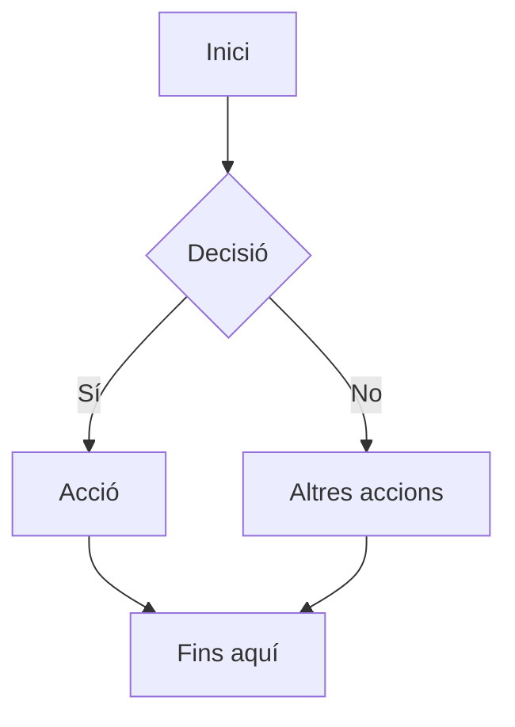

## **Creació de Diagrames Mermaid**

Una de les funcionalitats de **Mkdocs Material** és la capacitat d'integrar **diagrames Mermaid** en la nostra documentació. **Mermaid** és un llenguatge basat en text que permet crear diagrames i gràfics de manera senzilla. Aquests diagrames poden ser de diversos tipus: fluxos, gràfics de xarxa, de Gantt, de sequència, i més. El millor és que els podem crear directament en Markdown, utilitzant una sintaxi molt senzilla.

### **1. Instal·lació de l'extensió Mermaid**

Per començar a utilitzar **Mermaid** amb **Mkdocs**, cal instal·lar l'extensió **Pymdown Extensions**, que inclou el suport per a **Mermaid**. Això permetrà que els diagrames Mermaid es renderitzen correctament dins del lloc web generat per **Mkdocs**.

1. **Instal·lació** de **Pymdown Extensions**:

   ```bash
   pip install pymdown-extensions
   ```

2. **Configuració al fitxer `mkdocs.yml`**:

    Una vegada instal·lada l'extensió, hem d’afegir-la al fitxer de configuració `mkdocs.yml` per activar-la. Afegeix la següent configuració a la secció de `markdown_extensions`:

    ```yaml
    - pymdownx.superfences:
        custom_fences:
          - name: mermaid
            class: mermaid
            format: !!python/name:pymdownx.superfences.fence_code_format
    ```

   L'extensió **superfences** és la que permet a **Mkdocs** identificar i renderitzar correctament els diagrames Mermaid.

### **2. Sintaxi de Mermaid**

Després de configurar, podem començar a utilitzar **Mermaid** a la nostra documentació amb la sintaxi següent:

```` markdown title="Diagrama de flux"

````


En aquest exemple, estem creant un **diagrama de flux** senzill amb les següents característiques:

- **A** és el punt inicial.
- **B** és una decisió (en forma de diamant).
- **C** i **D** són accions depenent de la decisió.
- **E** és el final del flux.

### **3. Tipus de diagrames disponibles**

Amb **Mermaid**, podem crear diversos tipus de diagrames. Alguns dels més comuns inclouen:

1. **Diagrama de flux (Flowchart)**:
   
    Utilitzant la sintaxi **`graph TD`** (top-down):

    ```` markdown title="Diagrama de flux"
    ``` mermaid
    graph TD;
    A --> B --> C;
    B --> D;
    ```
    ````

    ``` mermaid
    graph TD;
    A --> B --> C;
    B --> D;
    ```

2. **Diagrama de seqüència (Sequence Diagram)**:
    Per descriure escenaris amb múltiples actors que interacciones entre ells:

    ```` markdown title="Diagrama de seqüència"
    ``` mermaid
    sequenceDiagram
    autonumber
    Alice->>John: Hello John, how are you?
    loop Healthcheck
        John->>John: Fight against hypochondria
    end
    Note right of John: Rational thoughts!
    John-->>Alice: Great!
    John->>Bob: How about you?
    Bob-->>John: Jolly good!
    ```
    ````

    ``` mermaid
    sequenceDiagram
        autonumber
        Alice->>John: Hello John, how are you?
        loop Healthcheck
            John->>John: Fight against hypochondria
        end
        Note right of John: Rational thoughts!
        John-->>Alice: Great!
        John->>Bob: How about you?
        Bob-->>John: Jolly good!
    ```

3. **Diagrames d'Estat (State Diagram)**:
   Per a descriure el comportament de sistemes finits.
   ```` markdown title="Diagrames d'estat"
   ``` mermaid
    stateDiagram-v2
    state fork_state <<fork>>
        [*] --> fork_state
        fork_state --> State2
        fork_state --> State3

        state join_state <<join>>
        State2 --> join_state
        State3 --> join_state
        join_state --> State4
        State4 --> [*]
    ```
   ````

    ``` mermaid
    stateDiagram-v2
    state fork_state <<fork>>
        [*] --> fork_state
        fork_state --> State2
        fork_state --> State3

        state join_state <<join>>
        State2 --> join_state
        State3 --> join_state
        join_state --> State4
        State4 --> [*]
    ```

4. **Diagrames entitat-relació (E-R Diagram)**:
   Per representar coses interrelacionades en un domini de coneixement específic.

    ```` markdown title="Diagrames entitat-relació"
    ``` mermaid
    erDiagram
    CUSTOMER ||--o{ ORDER : places
    ORDER ||--|{ LINE-ITEM : contains
    LINE-ITEM {
        string name
        int pricePerUnit
    }
    CUSTOMER }|..|{ DELIVERY-ADDRESS : uses
    ```
    ```` 


    ``` mermaid
    erDiagram
    CUSTOMER ||--o{ ORDER : places
    ORDER ||--|{ LINE-ITEM : contains
    LINE-ITEM {
        string name
        int pricePerUnit
    }
    CUSTOMER }|..|{ DELIVERY-ADDRESS : uses
    ```

5. **Diagrama de classe (Class Diagram)**:
   Per mostrar la relació entre classes en un sistema orientat a objectes.

    ```` markdown title="Diagrames de classe"
    ``` mermaid
    classDiagram
    Person <|-- Student
    Person <|-- Professor
    Person : +String name
    Person : +String phoneNumber
    Person : +String emailAddress
    Person: +purchaseParkingPass()
    Address "1" <-- "0..1" Person:lives at
    class Student{
        +int studentNumber
        +int averageMark
        +isEligibleToEnrol()
        +getSeminarsTaken()
    }
    class Professor{
        +int salary
    }
    class Address{
        +String street
        +String city
        +String state
        +int postalCode
        +String country
        -validate()
        +outputAsLabel()
    }
    ```
    ````

    ``` mermaid
    classDiagram
    Person <|-- Student
    Person <|-- Professor
    Person : +String name
    Person : +String phoneNumber
    Person : +String emailAddress
    Person: +purchaseParkingPass()
    Address "1" <-- "0..1" Person:lives at
    class Student{
        +int studentNumber
        +int averageMark
        +isEligibleToEnrol()
        +getSeminarsTaken()
    }
    class Professor{
        +int salary
    }
    class Address{
        +String street
        +String city
        +String state
        +int postalCode
        +String country
        -validate()
        +outputAsLabel()
    }
    ```

6. **Diagrames circulars (Pie Chart)**:
   Per crear gràfics circulars.

    ```` markdown title="Diagrames circulars"
    ```mermaid
    pie title Pets adopted by volunteers
        "Dogs" : 386
        "Cats" : 85
        "Rabbits" : 15
    ```
    ````

    ```mermaid
    pie title Pets adopted by volunteers
        "Dogs" : 386
        "Cats" : 85
        "Rabbits" : 15
    ```

7. **Diagrames de Gantt (Gantt Diagrams)**:
    Per a mostrar cronologies de projectes.

    ```` markdown title="Diagrames de Gantt"
    ```mermaid
    gantt
    title A Gantt Diagram
    dateFormat YYYY-MM-DD
    section Section
        A task          :a1, 2014-01-01, 10d
        Another task    :after a1, 20d
    section Another
        Task in Another :2014-01-12, 12d
        another task    :24d

    ```
    ````

    ```mermaid
    gantt
    title A Gantt Diagram
    dateFormat YYYY-MM-DD
    section Section
        A task          :a1, 2014-01-01, 10d
        Another task    :after a1, 20d
    section Another
        Task in Another :2014-01-12, 12d
        another task    :24d

    ```

!!! tip "Altres diagrames"
    Exixteixen altres diagrames disponibles. Pots consultar més informació als següents enllaços:
    
    * [Diagrames MkDocs Material]([text](https://squidfunk.github.io/mkdocs-material/reference/diagrams/#other-diagram-types))
    * [Mermaid]([text](https://mermaid.js.org/))


### **4. Consells i bones pràctiques**

- **Tipus de diagrames**: És important saber quin tipus de diagrama s'adapta millor a la informació que vols presentar. Els diagrames de flux són ideals per a processos, mentre que els de Gantt són més útils per a cronologies.
- **Claritat**: Intenta mantenir els diagrames simples i nets. Un diagrama excessivament complex pot ser difícil d'entendre.
- **Proves i ajustos**: Els diagrames poden tindre xicotets errors de visualització. Si no es veu bé, prova de simplificar-lo o ajustar la sintaxi.
